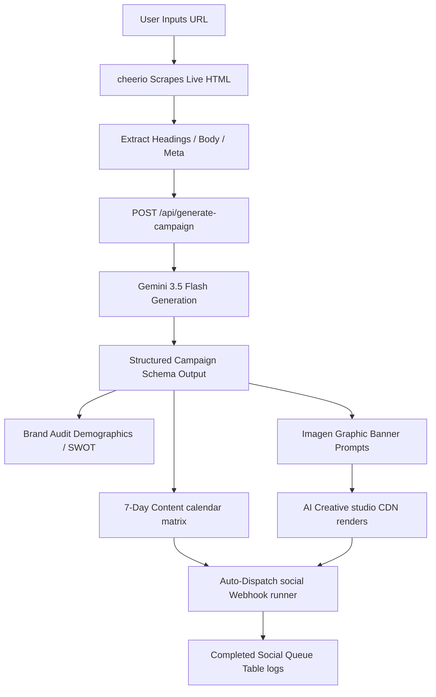

# ⚡ AUTOMARKETER AI

An autonomous campaign setup engine styled strictly in **NEO-BRUTALIST WEB DESIGN** for the PromptWars Hackathon. AutoMarketer AI visits target domains in real time, parses brand signals and content, audits niche positioning, maps a 7-day social media calendar, generates graphic banners, and deploys social webhook queues automatically.

---

## 🎨 NEO-BRUTALIST STYLING RULES
*   **Palette**: Off-White (`#F4F0EA`), Electric Yellow (`#FFE600`), Mint Green (`#00FF9D`), Hot Orange (`#FF5C00`), Retro Lavender (`#E2D4FF`), and Retro Blue (`#70A5FF`).
*   **Borders**: Solid high-contrast black borders (`border-4 border-black`).
*   **Shadows**: Flat 2D projections with zero blur (`shadow-[6px_6px_0px_0px_rgba(0,0,0,1)]`).
*   **Typography**: Uppercase condensed headers (`font-anton`), monospaced logs (`font-mono`), and clean body copy (`font-archivo`).

---

## ⚙️ ARCHITECTURE & PIPELINE FLOW



---

## 🔒 SECURITY & SANITIZATION
This repository is configured with zero security risks:
*   **Ignored Envs**: All local `.env` and `.env.*.local` files are ignored via `.gitignore` to prevent secret leakages.
*   **Runtime Fallbacks**: If the API key is missing or fails, the engine seamlessly fails over to high-fidelity mock audits.

---

## 🚀 RUNNING LOCALLY

1.  **Clone the Repository**:
    ```bash
    git clone https://github.com/sujoyyy/AutoMarketer-AI.git
    cd AutoMarketer-AI
    ```

2.  **Install Dependencies**:
    ```bash
    npm install
    ```

3.  **Configure API Keys**:
    Create `.env.local` in the project root:
    ```env
    GEMINI_API_KEY=your_gemini_api_key_here
    ```

4.  **Launch Dev Server**:
    ```bash
    npm run dev
    ```
    Open [http://localhost:3000](http://localhost:3000).

---

## 👤 AUTHOR & CREDITS
Built by **Sujoy** for the PromptWars Hackathon on Google Antigravity.
*   **GitHub**: [@sujoyyy](https://github.com/sujoyyy)
