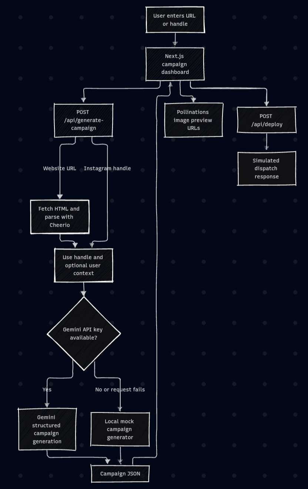

# AutoMarketer AI

AutoMarketer AI is a web application for creating a first draft of a social media campaign from a website URL or an Instagram handle. It gathers available brand context, produces a structured brand audit and seven day content calendar, and suggests ad slogans and image prompts.

The project is built with Next.js, React, TypeScript, and Cheerio. Campaign generation can use the Google Gemini API when configured. Without a working Gemini key, the server returns locally generated sample campaign data. The deploy endpoint is a demonstration queue: it does not publish to any social network.

## Project at a glance

| Item | Details |
| --- | --- |
| Project type | AI assisted campaign planning web application |
| Main input | Website URL or Instagram handle, with optional brand details |
| Main output | Brand audit, seven social posts, slogans, growth suggestions, and image prompts |
| Framework | Next.js 16 App Router, React 19, and TypeScript |
| AI service | Google Gemini through `@google/generative-ai` (optional) |
| Website parsing | Cheerio |
| Creative preview | Pollinations image URLs constructed from image prompts |
| Publishing | Simulated queue response only; no platform publishing integration |
| Data storage | In-memory client state; no database configured |

## Contents

1. [Introduction](#1-introduction)
2. [Requirement Analysis](#2-requirement-analysis)
3. [Knowledge Collection](#3-knowledge-collection)
4. [System Design](#4-system-design)
5. [System Implementation](#5-system-implementation)
6. [Testing and Verification](#6-testing-and-verification)
7. [Results](#7-results)
8. [Conclusion](#8-conclusion)
9. [References](#9-references)
10. [Run Locally](#run-locally)

## 1. Introduction

### 1.1 Problem definition

Planning a campaign requires a brand to understand its audience, identify useful content themes, and write posts and creative concepts for multiple channels. For small businesses and independent teams, preparing this material from scratch can be time consuming. The result may also be inconsistent when campaign content is created without a shared view of the brand.

### 1.2 Project objective

The objective is to provide a single dashboard that turns a small amount of brand information into a structured campaign draft. Users can start with a public website or an Instagram handle and optionally provide a bio, product details, and audience description to improve the context available to generation.

### 1.3 Project scope

The application currently provides:

- Website metadata and text extraction where the target site permits fetching.
- An Instagram handle workflow that uses the handle and any supplied context. It does not scrape Instagram.
- AI generated campaign content through Gemini when a key is available.
- A local mock campaign generator as a fallback and for trying the interface without Gemini.
- A brand audit, seven day content calendar, slogans, growth suggestions, and image prompts.
- A dashboard with audit, calendar, creative, and queue views.
- A simulated deploy request that returns a job identifier and timestamp.

The current scope does not include social account authorization, actual social publishing, campaign persistence, user accounts, or a database.

### 1.4 Intended users

The prototype is suitable for small business owners, creators, marketers, and students who want a quick starting point for planning campaign content. It is a drafting aid; outputs should be checked and edited before use.

## 2. Requirement Analysis

### 2.1 Functional requirements

1. Accept a website URL or a handle beginning with `@`.
2. Optionally collect a brand bio, product information, and target audience.
3. Attempt to fetch and parse public website HTML for website inputs.
4. Generate campaign data in a predictable JSON structure.
5. Provide fallback campaign data if Gemini is not configured or its request fails.
6. Present the results in the dashboard, separated into audit, calendar, creative, and queue areas.
7. Allow a calendar post or creative to be submitted to the simulated deploy endpoint.
8. Display queue progress and simulated dispatch details to the user.

### 2.2 Non-functional requirements

- Provide a responsive browser based interface.
- Keep the Gemini key on the server in an environment variable.
- Clearly distinguish generated campaign suggestions from actual publishing behavior.
- Handle unavailable websites or AI generation by returning fallback content where possible.
- Avoid requiring specialized hardware; an ordinary development computer is sufficient.

### 2.3 Software requirements

- Node.js (use a current version supported by the installed Next.js release)
- npm
- Next.js 16.3.0
- React and React DOM 19.2.8
- TypeScript 5
- Cheerio 1.2.0
- `@google/generative-ai` 0.24.1
- Framer Motion and Lucide React for UI animation and icons

Exact dependency versions and scripts are recorded in `package.json` and `package-lock.json`.

### 2.4 Hardware and network requirements

A standard laptop or desktop computer capable of running Node.js and a modern browser is sufficient. No GPU is required. Internet access is needed to install packages, request website pages, contact Gemini when configured, and load creative previews from Pollinations.

## 3. Knowledge Collection

### 3.1 Input sources

The generation flow can use two kinds of input:

- **Website URL:** The server attempts an HTTP fetch and parses the returned HTML.
- **Instagram handle:** The application uses the handle as a text signal. It does not log in to Instagram or retrieve profile data.
- **Optional user context:** The form can provide a short brand bio, product descriptions, and a target audience. This can supplement either input type.

### 3.2 Website data extraction

The scraper in `src/app/api/generate-campaign/route.ts` attempts to read the document title, Open Graph title, meta description, Open Graph description, up to ten headings, and up to fifteen paragraph elements (limited to 1,500 characters). Script, style, navigation, footer, iframe, and noscript elements are removed before text extraction.

Some websites may block automated requests, require JavaScript to render content, or provide little useful text in their HTML. In those cases, the application falls back to analysis based on the domain or handle and the user supplied context.

### 3.3 Campaign data produced

The campaign response is organized into four top-level fields:

- `brandAudit`: business niche, target audience, SWOT strengths and weaknesses, a score, and growth suggestions.
- `contentCalendar`: seven posts with day, platform, title, caption, and visual prompt.
- `adSlogans`: short campaign slogan ideas.
- `imagePrompts`: visual descriptions used to build creative previews.

### 3.4 Generation and fallback behavior

When `GEMINI_API_KEY` is available, the route requests structured JSON from Gemini using the campaign schema. If the key is missing or the Gemini call or JSON parsing fails, the route invokes a local mock generator. The fallback contains preset sample ideas and simple context matching for several niches; it is not an AI model and should not be treated as a factual audit.

## 4. System Design

### 4.1 Architecture diagram



### 4.2 Application components

| Component | Responsibility |
| --- | --- |
| `src/app/page.tsx` | Client dashboard, form state, result views, logs, creative previews, and simulated queue interaction |
| `src/app/api/generate-campaign/route.ts` | Request validation, website scraping, Gemini request, and mock fallback generation |
| `src/app/api/deploy/route.ts` | Validates platform and content, simulates a short delay, and returns a generated job ID |
| `src/app/layout.tsx` | Root layout, fonts, and page metadata |
| `src/app/globals.css` | Global styles and design foundation |

### 4.3 API endpoints

#### Generate campaign

`POST /api/generate-campaign`

Example request:

```json
{
  "urlOrHandle": "https://example.com",
  "userContext": {
    "bio": "Independent skincare brand focused on simple routines",
    "products": "Face cleanser and daily moisturizer",
    "audience": "Adults looking for fragrance-free skincare"
  }
}
```

For a handle, set `urlOrHandle` to a value such as `@examplebrand`. `userContext` may be omitted or set to `null`.

Example response shape (values abbreviated):

```json
{
  "brandAudit": {
    "niche": "Skincare",
    "targetAudience": "Adults interested in simple skincare routines",
    "swot": {
      "strengths": ["Example strength"],
      "weaknesses": ["Example opportunity"]
    },
    "score": 85,
    "growthHacks": ["Example growth suggestion"]
  },
  "contentCalendar": [
    {
      "day": "Day 1",
      "platform": "Instagram Reel",
      "postTitle": "Example post",
      "caption": "Example caption",
      "visualPrompt": "Example visual description"
    }
  ],
  "adSlogans": ["Example slogan"],
  "imagePrompts": ["Example image prompt"]
}
```

The real campaign calendar contains seven items. The route returns HTTP 400 when `urlOrHandle` is missing. Other unexpected server errors return an error response.

#### Simulated deploy

`POST /api/deploy`

Example request:

```json
{
  "platform": "Instagram",
  "content": "A draft post caption or creative description"
}
```

A successful response includes `success`, `dispatchedAt`, `jobId`, and `platform`. This response represents a simulated queue operation and is not evidence that content was sent to a platform. Missing `platform` or `content` returns HTTP 400.

### 4.4 Campaign workflow

1. The user enters a URL or handle and optionally fills in brand context.
2. The dashboard sends the input to the campaign API route.
3. The route attempts website extraction for URL inputs. Handle inputs skip website fetching.
4. Extracted content and user context are passed to Gemini if the key is configured.
5. If Gemini is unavailable or errors, the route creates mock campaign data.
6. The dashboard renders the audit and calendar, then derives creative preview URLs from image prompts.
7. When the user queues an item, the deploy route returns simulated dispatch information and the dashboard updates its local queue state.

## 5. System Implementation

### 5.1 Frontend implementation

The interface is a client rendered React page built in `src/app/page.tsx`. It manages form fields, loading state, campaign data, activity messages, the selected result tab, and queue entries using React state. Framer Motion supplies interface transitions, while Lucide React and small inline SVG components provide icons.

The available result views are:

- **Audit:** niche, audience, score, SWOT, and growth ideas.
- **Calendar:** seven day plan with platform, title, caption, and visual direction.
- **Creatives:** campaign slogans and generated image previews.
- **Queue:** queued items and simulated dispatch state.

### 5.2 Backend implementation

The campaign route normalizes website inputs by adding `https://` when no HTTP scheme is supplied. It uses `fetch` to retrieve the page and Cheerio to select relevant metadata and text. The route then constructs a prompt and requests JSON output from the Gemini model configured in the source. Any missing key or handled Gemini error leads to mock output.

The deploy route checks that both `platform` and `content` are present, waits for a short simulated processing interval, and returns a randomly generated job ID and the current timestamp. It does not call an external social API.

### 5.3 Environment configuration

Create `.env.local` in the repository root to enable Gemini generation:

```env
GEMINI_API_KEY=your_gemini_api_key_here
```

The server route also checks `NEXT_PUBLIC_GEMINI_API_KEY` as a fallback, but a server-only `GEMINI_API_KEY` is preferred because public-prefixed variables can be exposed to browser bundles in many frameworks. Do not commit real API keys. Environment files are ignored by `.gitignore`.

If the key is not set, the application uses its built-in mock generator. Restart the development server after changing environment variables.

### 5.4 Data storage and external services

The application has no database layer. Campaign and queue data live in client-side React state and are not retained after a reload. Gemini requests are made by the server route. Creative preview URLs are assembled in the browser using Pollinations; availability and output are subject to that external service.

### 5.5 User interface design

The dashboard follows a neo brutalist visual direction. It uses an off-white foundation, accent colors including electric yellow, mint, orange, lavender, and blue, thick black borders, uppercase display headings, and hard-edged shadows. The visual style is intended to make campaign cards and status areas easy to distinguish.

## 6. Testing and Verification

There is currently no automated test suite or dedicated test script in `package.json`. The available project scripts are `dev`, `build`, `start`, and `lint`.

Suggested manual verification checklist:

1. Open the dashboard and confirm that its main form and result areas render.
2. Submit a reachable website URL and inspect the returned brand audit and seven calendar entries.
3. Submit an `@handle` with bio, product, and audience details.
4. Run without `GEMINI_API_KEY` and confirm that fallback content is returned.
5. If a valid key is available, confirm that Gemini output follows the expected response shape.
6. Submit a post or creative to the queue and confirm the simulated response appears in the queue view.
7. Try a missing campaign input and a deploy request without required fields; confirm that the API returns a client error.
8. Try a blocked or unreachable website and review the fallback result and development server logs.

These checks are recommendations. They are not a claim that all scenarios have been executed. AI output quality should be reviewed separately for accuracy, relevance, and brand suitability.

## 7. Results

When the generation flow succeeds, the application displays a campaign package containing a brand audit, seven social content ideas, slogans, and image prompts. The creative section turns prompts into image preview URLs. The queue view demonstrates the shape of a future dispatch workflow by showing queued and simulated dispatch states.

This repository does not include measured campaign performance, prediction accuracy, user study results, or benchmark comparisons. Generated scores and suggestions are campaign draft content, not validated business metrics. The mock fallback is intended to demonstrate the interface and is not a reliable assessment of a real business.

## 8. Conclusion

### 8.1 Advantages

- Converts limited brand context into several useful campaign planning artifacts.
- Gives the user a structured seven day calendar rather than an unorganized list of ideas.
- Can be explored without a Gemini API key through a mock fallback.
- Keeps analysis, content planning, creative direction, and queue demonstration in one interface.

### 8.2 Limitations

- Website extraction depends on the site being accessible to server side requests and exposing useful HTML content.
- Instagram profiles are not fetched; the handle itself is only a text clue.
- Gemini output may be inaccurate, incomplete, or inconsistent and should be reviewed.
- The fallback generator uses preset examples and simple keyword matching.
- Dispatch is simulated; no social media platform receives the content.
- Campaign and queue state are not persisted to a database.
- Creative previews depend on an external image service.

### 8.3 Future improvements

- Add real social platform integrations with account authorization, review steps, and publishing controls.
- Store campaigns and queue history in a database.
- Add stronger URL validation, request timeouts, size limits, and clearer scraper error states.
- Add unit and integration tests for the API routes, campaign schema, and key user flows.
- Support campaign editing, export, and regeneration of individual calendar entries.
- Track evaluation feedback and distinguish generated estimates from measured performance.
- Add accessibility checks and responsive layout verification across devices.

## 9. References

- [Next.js documentation](https://nextjs.org/docs)
- [Google Generative AI JavaScript SDK](https://github.com/google-gemini/generative-ai-js)
- [Cheerio documentation](https://cheerio.js.org/)
- [Framer Motion documentation](https://motion.dev/docs/react)
- [Lucide React](https://lucide.dev/guide/packages/lucide-react)
- [Pollinations](https://pollinations.ai/)

## Run Locally

### Prerequisites

Install Node.js and npm. Confirm they are available in your terminal:

```bash
node --version
npm --version
```

### Install dependencies

```bash
git clone https://github.com/sujoyyy/AutoMarketer-AI.git
cd AutoMarketer-AI
npm install
```

If you already have the project files, open a terminal in the project root and run `npm install`.

### Configure Gemini (optional)

Create `.env.local` at the root of the project and add:

```env
GEMINI_API_KEY=your_gemini_api_key_here
```

Without this key, the mock campaign generator is used. Keep the key private and do not paste it into client-side code or commit it to Git.

### Start development server

```bash
npm run dev
```

Open [http://localhost:3000](http://localhost:3000) in a browser. Enter a website URL or an Instagram handle. For a handle, adding a bio, products, and audience details gives the campaign generator more context.

### Available npm scripts

| Command | Description |
| --- | --- |
| `npm run dev` | Start the local Next.js development server. |
| `npm run build` | Create a production build. |
| `npm start` | Start the production server after building. |
| `npm run lint` | Run ESLint on the project. |

---

